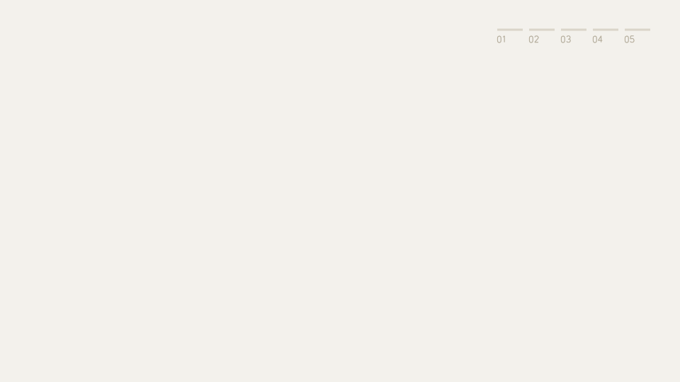

# dorocap


dorocap is a command-line tool for penetration testers. It keeps the evidence
of each engagement in one folder, tracks findings as Markdown files, and
exports a Markdown report. Every capture gets a SHA-256 hash, and dorocap
checks those hashes before it writes or finalizes the report.



A labeled diagram of the same flow is in
[docs/dorocap-data-flow.html](docs/dorocap-data-flow.html). Download it and
open it in a browser; GitHub shows only its source.

## Contents

- [Requirements](#requirements)
- [Install](#install)
- [Quick start](#quick-start)
- [Engagement folder](#engagement-folder)
- [Commands](#commands)
- [scope.yaml](#scopeyaml)
- [Shell completion](#shell-completion)
- [Terminal output](#terminal-output)
- [Development](#development)
- [Security](#security)
- [License](#license)

## Requirements

- macOS or Linux. Windows is not supported.
- Go 1.26 or newer, to build from source.
- For screenshots, a native capture tool: macOS uses the built-in
  `screencapture`; Linux needs `scrot`, `gnome-screenshot`, or ImageMagick's
  `import`.

On macOS, allow your terminal app under **System Settings → Privacy &
Security → Screen & System Audio Recording** before your first screenshot.

## Install

```bash
git clone https://github.com/0xF3tt/dorocap.git
cd dorocap
make install
```

`make install` puts `dorocap` in `$(go env GOPATH)/bin`. Add that directory to
your `PATH` if it is not there already.

If you download a binary from the Releases page instead, check its checksum
and its build attestation before you run it:

```bash
shasum -a 256 -c SHA256SUMS --ignore-missing
gh attestation verify dorocap-<version>-<os>-<arch> -R 0xF3tt/dorocap \
  --signer-workflow 0xF3tt/dorocap/.github/workflows/release.yml
```

## Quick start

```bash
dorocap init acme-2026      # create ./acme-2026 and make it the active engagement
# Fill in acme-2026/scope.yaml: client, dates, scope, and contacts.

dorocap ss exploitation "Admin session cookie obtained"   # select an area to screenshot
dorocap ss file ~/Downloads/nmap.txt "Initial port scan"  # import an existing file

dorocap finding add "Unnecessary service exposed" --severity med
dorocap finding link 0001 evidence/files/<Tab>
dorocap note recon "Service confirmed from the external network"

dorocap verify              # check every evidence hash
dorocap export              # write report/draft/report.md
# Review the draft, then:
dorocap finalize            # copy it to report/final/report.md
```

After `init`, these commands work from any directory. Evidence file names
start with a timestamp and a random ID, so let Tab complete the path in
`finding link` (see [Shell completion](#shell-completion)), or copy it from
the output of `ss`.

## Engagement folder

`dorocap init acme-2026` creates this tree in the current directory and prints
it:

```text
acme-2026/
├── scope.yaml          engagement name, client, dates, scope, and contacts
├── evidence/           captured artifacts with SHA-256 JSON sidecars
│   ├── recon/          discovery, enumeration, and mapping evidence
│   ├── staging/        setup, payload preparation, and pre-exploitation evidence
│   ├── exploitation/   proof of exploitation and vulnerability evidence
│   ├── postex/         impact, privilege, persistence, and cleanup evidence
│   └── files/          files imported with "dorocap ss file"
├── notes/              timestamped notes grouped by engagement phase
├── findings/           editable Markdown vulnerability records
└── report/
    ├── draft/          generated report from "dorocap export"
    └── final/          finalized deliverables managed by the operator
```

Inside an engagement folder, commands use that engagement. Anywhere else they
use the active engagement, which `init` sets. `dorocap info` shows which
engagement is in use, and `dorocap path <dir>` switches to another one.

Each capture is saved next to a `.json` sidecar that records where it came
from and its SHA-256 hash:

```json
{
  "timestamp": "2026-07-10T15:25:48.565649Z",
  "host": "laptop.local",
  "type": "file",
  "note": "Initial port scan",
  "source": "nmap.txt",
  "sha256": "f803fb6407e2226360013cb289a728a5b94d76671229fbe70e598789098aac90"
}
```

## Commands

```text
dorocap init <name>                          create ./<name> and make it the active engagement
dorocap info                                 show the active engagement and how it was found
dorocap path [<dir>]                         show or set the engagement used outside an engagement folder
dorocap ss <category> [note...]              take a screenshot into evidence/<category>/
dorocap ss file <path> [note...]             import a file into evidence/files/
dorocap note <category> <text...>            append a timestamped note
dorocap finding add -i                       create a finding, prompting for each field
dorocap finding add <title> [options]        create a finding in one command
dorocap finding set <id> -i                  edit a finding, prompting for each field
dorocap finding set <id> <field> <value>     change one field of a finding
dorocap finding link <id> <path> [--retest]  link evidence to a finding
dorocap finding list                         list findings
dorocap verify                               check evidence files, sidecars, hashes, and links
dorocap export                               write report/draft/report.md
dorocap finalize [--accept-edits]            verify, then copy the draft to report/final/
dorocap completion <shell>                   print a zsh, bash, fish, or powershell completion script
dorocap version                              print the version
```

### Capture evidence

Screenshot categories are `recon`, `staging`, `exploitation`, and `postex`.
`dorocap ss <category>` opens your system's screenshot tool so you can select
what to capture. The note after the category is optional and is stored in the
sidecar. `dorocap ss file <path>` copies an existing file into
`evidence/files/` instead.

### Findings

`dorocap finding add -i` asks for the title, severity, status, asset, CVSS,
CWE, and OWASP category, then for the description, business and technical
impact, steps to reproduce, remediation, and references. Press Enter to accept
a default or skip a field.

| Field | Values | Default |
| --- | --- | --- |
| `severity` | `crit`, `high`, `med`, `low`, `info` | `info` |
| `status` | `open`, `resolved`, `partially-resolved`, `accepted-risk`, `not-applicable` | `open` |
| `asset` | the affected host, URL, IP, endpoint, or service | |
| `cvss` | a score from 0.0 to 10.0 | |
| `cwe`, `owasp` | for example `CWE-89` and `A03:2021 Injection` | |
| `retest-status` | `not-tested`, `resolved`, `still-vulnerable`, `partially-resolved` | `not-tested` |
| `retested` | the retest date | |

`finding add` also takes these fields as options (`--severity`, `--status`,
`--asset`, `--cvss`, `--cwe`, `--owasp`). `finding set` changes any field in
the table, including the retest fields:

```bash
dorocap finding add "SQL injection in login" --severity high \
  --asset example.com/login --cvss 8.8 --cwe CWE-89 --owasp "A03:2021 Injection"
dorocap finding set 0001 status partially-resolved
dorocap finding set 0001 retest-status still-vulnerable
dorocap finding set 0001 retested 2026-08-20
dorocap finding set 0001 cvss -    # "-" clears an optional field
```

`dorocap finding set <id> -i` shows the current values. Press Enter to keep a
value, or type `-` to clear it.

Each finding is a Markdown file in `findings/`, such as
`findings/0001-SQL-injection-in-login.md`. Edit its text sections in any
editor.

### Link evidence to a finding

```bash
dorocap finding link 0001 evidence/exploitation/<file>
dorocap finding link 0001 evidence/exploitation/<file> --retest   # evidence from a retest
```

A link records that the file supports the finding; the file stays where it
is. dorocap refuses paths outside `evidence/`, sidecar files, files that fail
verification, and links that already exist. In the report, linked evidence
appears under its finding.

### Notes

```bash
dorocap note recon "Ports 22, 80, and 443 are open"
```

Note categories are `recon`, `staging`, `exploitation`, `postex`, and `files`.
Notes are timestamped, saved in `notes/<category>.md`, and included in the
report.

### Verify, export, and finalize

`dorocap verify` checks that every evidence file has a sidecar and that its
hash and category still match. It also reports sidecars without a file,
symlinks, and finding links to missing or invalid evidence. It does not check
findings, notes, or `scope.yaml`.

`dorocap export` writes `report/draft/report.md`. The report has a cover and
revision history, an executive summary with severity totals, a risk summary,
the scope, methodology, and limitations, each finding with its evidence, a
remediation roadmap, the notes, and the verification results. PNG, JPEG, GIF,
and WebP evidence is embedded; other files are linked. The links are relative
(`../../evidence/...`), so keep the report inside the engagement folder or
send `evidence/` with it.

When verification passes, `export` also writes `report/draft/report.md.sha256`.
When it fails, `export` still writes the draft so you can read the warnings,
deletes any old checksum, and exits with an error.

`dorocap finalize` verifies the evidence again and copies the draft to
`report/final/report.md`, but only if the draft still matches its checksum.
It never regenerates the draft. If you edited the draft by hand, run
`dorocap finalize --accept-edits`: it saves a new checksum for your edited
draft, then copies it.

The hashes show whether evidence changed after capture. They are not a signed
chain of custody.

## scope.yaml

`init` creates `scope.yaml` with most fields empty. Fill it in by hand: `export`
uses it for the report's cover, summary, scope, contacts, restrictions,
methodology, limitations, and revision history. A filled-in example:

```yaml
# scope.yaml - engagement scope and rules of engagement
engagement: acme-2026
client: "Acme Corp"
assessment_type: "External Web Application Penetration Test"
testing_mode: "Gray-box"
classification: "Confidential"
report_version: "1.0"
prepared_by: "@0xF3tt"
start_date: "2026-07-10"
end_date: "2026-07-24"
executive_summary: "Acme requested an assessment of its external application."
overall_posture: "Elevated risk"
in_scope:
  - "*.acme.com"
  - "10.20.30.0/24"
out_of_scope:
  - "billing.acme.com"
  - "corporate VPN infrastructure"
contacts:
  - "Jane Doe <jane@acme.com> (primary technical contact)"
restrictions:
  - "No denial-of-service testing"
emergency_stop_conditions:
  - "Stop immediately if production availability degrades"
limitations:
  - "Payment processing was unavailable during testing"
methodology:
  - Reconnaissance
  - Enumeration
  - Vulnerability analysis
  - Exploitation
  - Post-exploitation
  - Evidence verification
  - Reporting
revision_history:
  - version: "1.0"
    date: "2026-07-25"
    author: "@0xF3tt"
    changes: "Final report"
```

- Keep the file: it marks the engagement's root folder, which is how commands
  find the engagement from a subfolder.
- `in_scope` and `out_of_scope` only appear in the report. dorocap does not
  check evidence against them.

## Shell completion

Set it up once for your shell, then open a new terminal:

```bash
# Zsh: add to ~/.zshrc, after compinit
source <(dorocap completion zsh)

# Bash: add to ~/.bashrc
eval "$(dorocap completion bash)"

# Fish: run once
mkdir -p ~/.config/fish/completions
dorocap completion fish > ~/.config/fish/completions/dorocap.fish

# PowerShell: add to $PROFILE
dorocap completion powershell | Out-String | Invoke-Expression
```

Tab then completes commands, categories, severities, finding IDs, and
evidence paths. After `dorocap finding link 0001`, it offers only verified
evidence that is not yet linked to that finding.

## Terminal output

- Colors turn off when output is redirected, when `TERM=dumb`, or when
  `NO_COLOR` is set.
- `DOROCAP_ASCII=1` draws trees and the banner with plain ASCII characters.
- `DOROCAP_NERD=1` adds Nerd Font icons, which are off by default.

## Development

```bash
make test     # unit tests
make lint     # gofmt check, go vet, golangci-lint (with staticcheck and gosec)
make audit    # gitleaks over the git history, then govulncheck
make release  # all checks, then macOS and Linux binaries, checksums, and an SBOM
```

`make lint` needs `golangci-lint` v2.15.0 on your `PATH` (install it with
brew or mise). The scanners in `make audit` and `make release` run through
`go run`, so they need no install. `make help` lists every target.

If you use [pre-commit](https://pre-commit.com), `pre-commit install` runs the
formatting, secret, lint, and test checks from `.pre-commit-config.yaml`
before each commit.

A pull request needs `make test`, `make lint`, and `make audit` to pass, and
CI runs the same checks. [docs/AUTOMATION.md](docs/AUTOMATION.md) explains CI,
CodeQL, Dependabot, and how releases are published.

## Security

dorocap runs locally with your user's permissions and opens no network port.
Treat engagement folders as sensitive client data. To report a vulnerability,
see [SECURITY.md](SECURITY.md).

## License

MIT. See [LICENSE](LICENSE).
