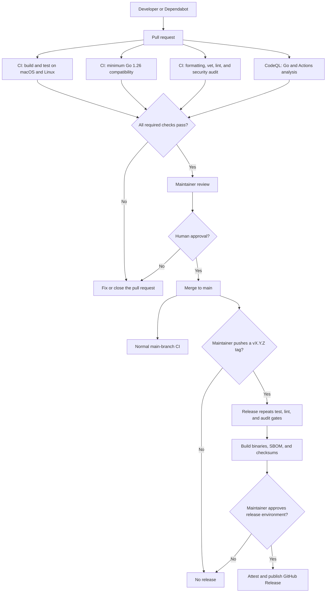

# Automation and CI

This document explains how dorocap changes move from a local edit to a reviewed
merge or release. The central rule is simple: automation may propose or verify
changes, but a human controls merges and releases.

## System flow

There is intentionally no `checks.yml`. The existing `ci.yml` is the single
general verification workflow; a second workflow containing the same commands
would add cost and duplicate status checks without adding a security boundary.

## Automation lanes

| Lane | Trigger | Responsibility | Allowed write |
| --- | --- | --- | --- |
| CI | Push to `main`, pull request, manual | Build, test, compatibility, lint, and vulnerability gates | None |
| CodeQL | Push/PR to `main`, weekly, manual | Semantic analysis of Go and GitHub Actions | Code-scanning results only |
| Dependabot | Monday schedule | Propose GitHub Actions and Go module updates | Dependency pull requests |
| Issue labels | An issue is opened | Add the `dorocap` label | Issue labels only |
| Release | A maintainer pushes `v*` | Re-run gates, build artifacts, and publish a release | Release assets and metadata |

These lanes overlap only where defense in depth is useful. Release repeats the
quality gates because a tag can be created independently of a prior workflow
run.

## CI checks

`.github/workflows/ci.yml` creates five status checks:

1. `build & test (ubuntu-latest)`
2. `build & test (macos-latest)`
3. `minimum Go compatibility (1.26.x)`
4. `lint & security audit`
5. `dependency review` (pull requests only)

The two operating-system jobs use the pinned current Go toolchain and run a
race-enabled, shuffled test suite. The compatibility job verifies the minimum
Go version promised by `go.mod` and the README. The security job runs:

- `gofmt` verification through `make fmt`
- `go vet`
- `staticcheck`
- `golangci-lint`
- `gosec`
- `govulncheck`
- `gitleaks`, over the full git history of the checkout

Pull requests also run `dependency review`. That job does not run on a push
to `main`; the `main` ruleset requires a pull request, so requiring it there
is safe.

`make fmt` is a check: it fails when formatting is wrong and does not rewrite
source files. Developers apply `gofmt` locally and then rerun the check.

All third-party Actions are pinned to full commit SHAs. Dependabot is the lane
that proposes updates to those pins. The `golangci-lint` binary version is also
pinned consistently between CI and release.

## CodeQL

`.github/workflows/codeql.yml` analyzes both `go` and `actions`. Its default
token remains read-only; only the analysis job receives the additional
`security-events: write` permission required to upload results. The scheduled
Saturday run can discover new findings even when the repository has not
changed.

CodeQL is not redundant with `gosec` or `govulncheck`:

- `gosec` checks Go security patterns.
- `govulncheck` correlates reachable code with known Go vulnerabilities.
- CodeQL performs broader semantic/data-flow analysis and also checks workflow
  code.

## Dependabot

`.github/dependabot.yml` owns dependency changes. It runs on Monday in the
`America/Monterrey` timezone and uses separate update queues for GitHub Actions
and Go modules. Minor and patch updates are grouped to reduce PR noise; major
updates remain separate so they receive focused review. A seven-day
`cooldown` skips versions published less than a week ago, which is when most
hijacked releases are caught and yanked. Security updates ignore the cooldown.
Security updates for `/tools` arrive as one grouped pull request: `main`
requires up-to-date branches, so separate pull requests would each need a
rebase after every merge.

Dependabot never auto-merges in this repository. Its PRs must pass the same CI,
CodeQL, and human review requirements as other changes.

## Release gate

`.github/workflows/release.yml` starts only for a pushed `v*` tag and then
rejects tags that do not look like `v1.2.3` or `v1.2.3-rc.1`. It serializes
runs per tag and splits the work into two jobs:

| Job | Token | Does |
| --- | --- | --- |
| `build` | `contents: read`, no OIDC | Installs pinned tools, runs `make release` (test, lint, audit, build), uploads `dist/` |
| `publish` | `contents: write`, `id-token: write`, `attestations: write` | Waits for the `release` environment approval, attests `dist/*`, creates the release |

Third-party tooling therefore never runs with a token that can write the
repository or sign attestations. The `build` job also disables the Go module
cache: a tag run can restore caches written by `main`, and a poisoned cache
would otherwise reach the signed binaries.

The release contains:

- Trimmed static binaries for supported macOS and Linux architectures, built
  with `CGO_ENABLED=0`, `-trimpath`, and `-buildvcs=false`
- A CycloneDX SBOM of the source module, not of the compiled binary
- SHA-256 checksums
- A build-provenance attestation for the files in `dist/`
- GitHub-generated release notes

A tag with a suffix, such as `v1.2.3-rc.1`, is published as a prerelease and
never becomes the latest release. Use one to test a release pipeline change
before tagging a final version: a published `v*` tag cannot be moved or
deleted afterwards.

The same Go patch used by CI (`1.27.3`) builds the release. The attestation
is the record that this workflow built those bytes; verify it with
`--signer-workflow 0xF3tt/dorocap/.github/workflows/release.yml` so an
attestation from any other workflow is rejected.

Creating or pushing the tag remains a human decision. Dependabot does not
receive tag or release authority. A tag ruleset blocks moving or deleting
`v*` tags, and immutable releases block replacing published assets.

## Required GitHub configuration

The workflows above rely on these repository settings:

1. Keep the repository's default `GITHUB_TOKEN` permission read-only. Grant
   additional permissions at job level only when required.
2. Create a `main` ruleset requiring a pull request merged by squash (the
   repository allows only squash merges, to match), resolved conversations,
   signed commits, the five CI checks listed above, `analyze (go)`,
   `analyze (actions)`, and code scanning results with no high-severity
   CodeQL alerts. The required checks only prove that CodeQL ran; the code
   scanning rule is what blocks a PR that adds an alert.
3. Block force pushes and branch deletion on `main`, and add a tag ruleset that
   blocks updating or deleting `v*` tags. Do not enable Dependabot auto-merge.
4. In Actions settings, allow only GitHub-owned actions plus
   `golangci/golangci-lint-action@*`, and require full-length SHA pins.
5. Create the `release` environment before the first tag, with `0xF3tt` as a
   required reviewer and a `v*` tag-only deployment policy. If it does not
   exist, GitHub creates it on the first release with no reviewer, and the
   approval gate silently disappears. Turn off administrator bypass so the
   approval applies to every account.
6. Turn on immutable releases before the first tag. They apply only to
   releases created afterwards.
7. Keep Dependabot alerts and security updates, private vulnerability
   reporting, secret scanning, and push protection enabled. Leave CodeQL
   default setup off: it conflicts with `codeql.yml`.

## Failure and recovery behavior

- A failing CI or CodeQL check blocks merge; fix the PR or close it.
- A failed release gate prevents publication. If publication partially fails,
  inspect the draft/release state before retrying; never move or overwrite an
  existing version tag silently.
- Roll back a merged code or documentation change with a normal reviewed revert
  PR. Released versions are immutable; publish a corrected patch version.

## Future phases

- Attest the SBOM as well as the binaries, and evaluate reproducible builds.
- Any automation that writes code or opens PRs needs its own threat model and
  an enforced path allowlist first. Evidence capture, hashing, export,
  configuration, workflows, dependencies, and releases stay human-controlled.
