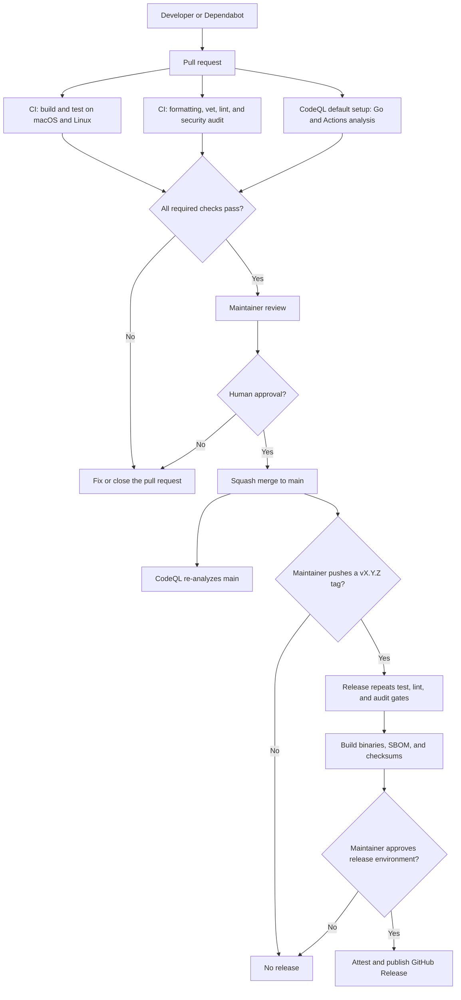

# Automation and CI

This document explains how dorocap changes move from a local edit to a reviewed
merge or release. The central rule is simple: automation may propose or verify
changes, but a human controls merges and releases.

## System flow

The repository has two workflow files: `ci.yml` for every pull request and
`release.yml` for version tags. CodeQL, Dependabot, and secret scanning are
GitHub-managed features configured in the repository settings, so they add
no workflow files or action pins to maintain.

## Automation lanes

| Lane | Trigger | Responsibility | Allowed write |
| --- | --- | --- | --- |
| CI | Pull request, manual | Build, test, lint, and vulnerability gates | None |
| CodeQL default setup | Pull request and push to `main`, weekly | Semantic analysis of Go and GitHub Actions | Code-scanning results only |
| Dependabot | Monthly | Propose grouped GitHub Actions and Go module updates | Dependency pull requests |
| Release | A maintainer pushes `v*` | Re-run gates, build artifacts, and publish a release | Release assets and metadata |

Release repeats the CI gates because a tag can point at any commit, tested or
not. CI does not run again after a merge: `main` requires an up-to-date
branch, so the pull request already tested the exact tree that lands.

## CI checks

`.github/workflows/ci.yml` creates four status checks:

1. `build & test (ubuntu-latest)`
2. `build & test (macos-latest)`
3. `lint & security audit`
4. `dependency review` (pull requests only)

The two operating-system jobs use the pinned Go toolchain and run a
race-enabled, shuffled test suite. There is no separate minimum-Go job: the
compiler rejects syntax newer than the `go 1.26` line in `go.mod`, and the
`stdversion` check in `go vet` flags standard-library APIs newer than that.

The security job runs:

- `gofmt` verification and `go vet` through `make fmt vet`
- `golangci-lint`, configured in `.golangci.yml`: the default linters,
  including `staticcheck`, plus `gosec`
- `make audit`: `gitleaks` over the full git history of the checkout, then
  `govulncheck`

`make fmt` only checks formatting and never rewrites files. Run `gofmt -w .`
to fix what it reports.

A `gosec` finding that is a false positive carries a
`//nolint:gosec // reason` comment on the flagged line. Fix real findings
instead of suppressing them.

Every third-party action is pinned to a full commit SHA, and Dependabot
proposes updates to those pins. The `golangci-lint` binary is different: its
version (`v2.15.0`) is the `version` input of the action in both workflows,
and Dependabot does not update it. Bump it by hand in both workflows and in
the README.

The scanners that `make audit` and `make release` run (`gitleaks`,
`govulncheck`, `cyclonedx-gomod`) are pinned by version at the top of the
`Makefile` and run with `go run pkg@version`. That builds each tool from its
own `go.mod` and verifies it against `sum.golang.org`, so the repository needs
no tools module, and the tools' roughly 150 indirect dependencies stay out of
Dependabot's graph. Dependabot does not see these versions: bump them by hand,
`gitleaks` together with its rev in `.pre-commit-config.yaml`.

## CodeQL

CodeQL runs as GitHub's default setup (Settings → Advanced Security → CodeQL
analysis), not as a workflow file. GitHub selects the languages (Go and GitHub
Actions), keeps the analysis current, and analyzes every pull request to
`main`, every push to `main`, and once a week, so new queries can find issues
in unchanged code. The `main` ruleset's code scanning rule blocks a pull
request that adds a CodeQL error or a high-severity security alert.

Do not add a CodeQL workflow while default setup is on: GitHub rejects uploads
from advanced configurations when default setup is enabled.

CodeQL is not redundant with `gosec` or `govulncheck`:

- `gosec` checks Go security patterns.
- `govulncheck` correlates reachable code with known Go vulnerabilities.
- CodeQL performs broader semantic/data-flow analysis and also checks workflow
  code.

## Dependabot

`.github/dependabot.yml` owns dependency changes for GitHub Actions and the Go
module. It runs monthly in the `America/Monterrey` timezone. All version
updates for an ecosystem, majors included, arrive as one pull request, and all
security fixes as another. `main` requires up-to-date branches, so every extra
pull request would mean another rebase after each merge. A seven-day
`cooldown` skips versions published less than a week ago, which is when most
hijacked releases are caught and yanked. Security updates ignore the cooldown.

Dependabot never auto-merges in this repository. Its PRs must pass the same CI,
CodeQL, and human review requirements as other changes.

## Release gate

`.github/workflows/release.yml` starts only for a pushed `v*` tag and then
rejects tags that do not look like `v1.2.3` or `v1.2.3-rc.1`. It serializes
runs per tag and splits the work into two jobs:

| Job | Token | Does |
| --- | --- | --- |
| `build` | `contents: read`, no OIDC | Runs `make release` (test, lint, audit, build, SBOM), uploads `dist/` |
| `publish` | `contents: write`, `id-token: write`, `attestations: write` | Waits for the `release` environment approval, attests `dist/*`, creates the release |

Third-party tooling therefore never runs with a token that can write the
repository or sign attestations. The `build` job also disables the Go module
cache: a tag run can restore caches written by `main`, and a poisoned cache
would otherwise reach the signed binaries.

The release contains:

- Trimmed static binaries for supported macOS and Linux architectures, built
  with `CGO_ENABLED=0`, `-trimpath`, and `-buildvcs=false`
- A CycloneDX SBOM of the source module, not of the compiled binary
- SHA-256 checksums
- A build-provenance attestation for the files in `dist/`
- GitHub-generated release notes

A tag with a suffix, such as `v1.2.3-rc.1`, is published as a prerelease and
never becomes the latest release. Use one to test a release pipeline change
before tagging a final version: a published `v*` tag cannot be moved or
deleted afterwards.

The same Go patch used by CI (`1.27.3`) builds the release. The attestation
is the record that this workflow built those bytes; verify it with
`--signer-workflow 0xF3tt/dorocap/.github/workflows/release.yml` so an
attestation from any other workflow is rejected.

Only a maintainer creates tags. A tag ruleset blocks moving or deleting `v*`
tags, and immutable releases block replacing published assets.

## Required GitHub configuration

The workflows above rely on these repository settings:

1. Keep the repository's default `GITHUB_TOKEN` permission read-only. Grant
   additional permissions at job level only when required.
2. Create a `main` ruleset requiring a pull request merged by squash (the
   repository allows only squash merges, to match), resolved conversations,
   signed commits, the four CI checks listed above, and code scanning results
   with no CodeQL errors or high-severity security alerts. The code scanning
   rule is what gates CodeQL; there is no CodeQL status check to require.
3. Block force pushes and branch deletion on `main`, and add a tag ruleset that
   blocks updating or deleting `v*` tags. Do not enable Dependabot auto-merge.
4. In Actions settings, allow only GitHub-owned actions plus
   `golangci/golangci-lint-action@*`, and require full-length SHA pins.
5. Create the `release` environment before the first tag, with `0xF3tt` as a
   required reviewer and a `v*` tag-only deployment policy. If it does not
   exist, GitHub creates it on the first release with no reviewer, and the
   approval gate silently disappears. Turn off administrator bypass so the
   approval applies to every account.
6. Turn on immutable releases before the first tag. They apply only to
   releases created afterwards.
7. Keep Dependabot alerts and security updates, private vulnerability
   reporting, secret scanning, and push protection enabled, and CodeQL default
   setup on for Go and GitHub Actions.

## Failure and recovery behavior

- A failing CI check or a new CodeQL alert blocks merge; fix the PR or close it.
- A failed release gate prevents publication. If publication partially fails,
  inspect the draft/release state before retrying; never move or overwrite an
  existing version tag silently.
- Roll back a merged code or documentation change with a normal reviewed revert
  PR. Released versions are immutable; publish a corrected patch version.

## Future phases

- Attest the SBOM as well as the binaries, and evaluate reproducible builds.
- Any automation that writes code or opens PRs needs its own threat model and
  an enforced path allowlist first. Evidence capture, hashing, export,
  configuration, workflows, dependencies, and releases stay human-controlled.
